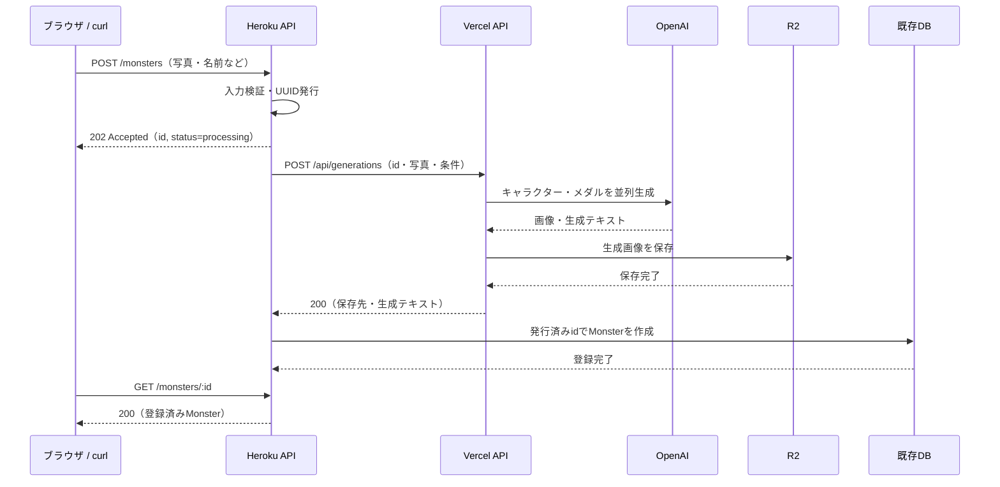

# 画像生成API分離・DB登録遅延の仕様

作成日・実装日: 2026-10-11（日本時間）。処理順と簡易的な実行方式は合意済み。以下の初期値で実装済み。

## 1. 目的と合意事項

HerokuのHTTPリクエストで画像生成の完了を待たず、30秒のルータータイムアウトを回避する。既存のExpress API・Prisma・DBスキーマ・CRUDの構成を維持する。

処理順は必ず「画像生成 → R2保存完了 → DB登録」とする。受付時にはUUIDを発行するだけで、DBレコードを作成しない。

Herokuは入力を検証した後、`202 Accepted` と登録予定のIDを返す。同じNode.jsプロセスで後続処理を続け、Vercelの画像生成APIを呼び、成功結果を受け取ってからDB登録する。

Workflow、永続ジョブキュー、worker dyno、ジョブ用テーブル、完了通知用APIは導入しない。途中失敗・再起動で処理が失われること、R2にDB未登録の画像が残ることを許容する。自動再試行・復旧・孤立画像の自動削除は初期版の対象外とする。

Herokuの30秒制限は応答を待つHTTPリクエストに適用される。先に応答を完了し、後続処理をそのリクエストの応答から切り離す。[Heroku Request Timeout](https://devcenter.heroku.com/articles/request-timeout)

## 2. 構成と処理の流れ

| 実行場所 | 役割 |
| --- | --- |
| ブラウザ / curl | Herokuへ写真と条件を送る。返されたIDで登録結果を確認する |
| Heroku | 入力検証、ID発行、202応答、Vercel API呼び出し、生成済みデータのDB登録 |
| Vercel | 写真からキャラクター・メダルを生成し、R2へ保存して保存先と生成テキストを返す |
| R2 | 生成画像の保存。入力写真は初期版では永続保存しない |
| 既存DB | R2保存が完了したMonsterだけを登録する |



Vercelは同期APIとし、HTTP応答前に画像生成とR2保存を完了させる。Vercelで応答後に処理を続ける実装は用いない。HerokuからVercelへのHTTP接続は生成中も継続するが、クライアントへのHerokuの応答はすでに完了している。

## 3. Heroku APIの仕様

### POST /monsters

既存のURLと`multipart/form-data`を使う。

| フィールド | 必須 | 内容 |
| --- | --- | --- |
| name | 必須 | 妖怪名。trim後に空なら400 |
| photo | 必須 | 人物写真1枚。初期対応はJPEG / PNG |
| skill | 任意 | とくぎの元になる文言。未指定時は空文字 |
| personality | 任意 | DBへ保存する性格。未指定時は空文字 |

入力検証、画像サイズ制限、接続先URL・API用トークンの設定確認を202応答前に行う。名前・写真の不備は400、サイズ超過は413、非対応形式は415、サーバー設定不備は503でJSONエラーを返す。後続処理用の入力値と写真Bufferを確保してから応答する。

受付成功時はHTTP 202、`Cache-Control: no-store`で次を返す。

```json
{
  "id": "550e8400-e29b-41d4-a716-446655440000",
  "status": "processing"
}
```

`id`は後で作成する`Monster.id`そのもの。`processing`は受付時の表現であり、保存・更新されるジョブ状態ではない。202は受付を意味し、処理開始や登録成功を保証しない。

応答後の処理:

1. 写真・ID・入力条件をVercelへ送る。
2. VercelのHTTPステータスと結果を検証する。IDの一致、必須画像の保存先、メダル保存先が文字列またはnullであること、skillが文字列であることを確認する。
3. VercelがR2保存完了を返した場合にのみ、`prisma.monster.create`を実行する。
4. `id`は受付時のUUID、`name`と`personality`は受付時の入力値、`imageFilename`・`medalFilename`・`skill`はVercelの結果を使用する。
5. 後続処理の例外を捕捉し、ログを残して終了する。202送信後には`res`を使って追加応答しない。

既存のDBスキーマを使い、処理中レコードや仮の画像ファイル名は登録しない。

### GET /monsters/:id

既存の取得APIを使う。200ならDB登録完了、404ならレコード未登録を意味する。404だけで処理中・失敗・未知のIDを区別しない。

確認リクエストには`Cache-Control: no-store`を適用し、フロントのfetchもキャッシュを使わない。

### その他のCRUD

`GET /monsters`、`PATCH /monsters/:id`、`DELETE /monsters/:id`の契約は継続する。一覧には登録完了したMonsterだけが現れる。

## 4. Vercel画像生成APIの仕様

### POST /api/generations

配置は既存Next.jsプロジェクトの`web/src/app/api/generations/route.ts`。VercelのRoot Directoryを`web`に設定し、既定のNode.js runtime・Fluid computeで実行する。`cacheComponents`と明示的なruntime指定が併用できないため、runtimeのexportは追加せず、`maxDuration = 300`のみ指定する。

Herokuおよび検証用curlから、`Authorization: Bearer <IMAGE_GENERATION_API_TOKEN>`で呼び出す。このトークンはOpenAIのAPIキーとは別で、ブラウザへ渡さない。

入力は`multipart/form-data`。Herokuの入力項目に、必須のUUIDフィールド`id`を追加する。VercelでもID・入力・写真サイズ・形式を検証する。

処理:

1. 既存の生成処理を関数として移し、OpenAIでキャラクター画像・メダル画像を並列生成する。
2. キャラクター画像は必須。メダル生成だけが失敗した場合は、現行の任意扱いに合わせて`medalFilename: null`で継続し、メダル生成失敗をログに残す。
3. 生成できた画像をPNGとしてR2へ保存する。保存先案はキャラクターが`<id>.png`、メダルが`<id>-medal.png`。
4. キャラクターと、生成できたメダルのR2保存がすべて成功するまで応答しない。生成できたメダルの保存に失敗した場合は、登録用の成功結果を返さない。
5. 成功時はHTTP 200、`Cache-Control: no-store`でJSONを返す。

```json
{
  "id": "550e8400-e29b-41d4-a716-446655440000",
  "imageFilename": "550e8400-e29b-41d4-a716-446655440000.png",
  "medalFilename": "550e8400-e29b-41d4-a716-446655440000-medal.png",
  "skill": "生成されたとくぎ"
}
```

JSONに画像Base64やdata URLは含めない。既存フロントは保存先キーと`NEXT_PUBLIC_R2_BASE_URL`から表示URLを構築する。VercelはDBに接続せず、Herokuへのコールバックも行わない。Vercelへ直接curlした場合、画像はR2へ保存されるがDB登録はされない。

| HTTP | 内容 |
| --- | --- |
| 400 | 必須項目・IDの不備 |
| 401 | API用トークンの不備 |
| 413 | 写真サイズ超過 |
| 415 | 非対応画像形式 |
| 422 | 生成拒否・必須画像の生成結果なし |
| 429 | 上流の利用制限 |
| 502 | 上流通信・不正応答・R2保存の失敗 |
| 503 | APIキーなどサーバー設定・上流認証の不備 |
| 504 | 生成・保存のタイムアウト |

アプリで処理できる失敗は`{ "success": false, "message": "…" }`形式に整える。Vercel自体による終了・サイズ制限ではJSON以外の応答もあり得るため、Herokuは非JSONの失敗も扱う。上流のエラー本文や認証情報を利用者へそのまま返さない。

## 5. フロントの仕様

`postMonster`は202の受付IDを読み取り、既存の`GET /monsters/:id`をポーリングして、200で得たMonsterを現在の結果表示へ渡す。呼び出し元へは現在と同じ完成結果の形式を返す設計とし、内部の受付・確認処理を`web/src/lib/api.ts`に集約する。

受付後はまず1回取得し、404なら3秒間隔で確認する。同じIDの確認を重複実行しない。200で確認を停止し、404以外のHTTPエラーや通信失敗はエラーとして確認を停止する。画面終了時も確認を停止する。画面終了やクライアント側の中断は、Herokuの後続処理を停止する操作ではない。

受付後330秒を確認期限の初期案とする。期限までに登録を確認できない場合は「時間内に登録を確認できませんでした」と表示する。サーバー側の失敗が確定したとは表示しない。確認停止後に登録される可能性もある。

処理中は送信ボタンを無効にする。自動で新しい生成依頼は送らない。手動で再送すると新しいIDで別の生成・登録処理が始まる。

現行の`postMonster`は引数にある`skill`・`personality`をFormDataへ追加していないため、接続時にこの2項目も送信する。`web/src/app/api/monsters/route.ts`のモックも、202受付と後続GETで登録を確認する流れに合わせる。

## 6. 入力・実行時間・設定の初期案

| 項目 | 初期値 |
| --- | --- |
| 写真上限 | 4,000,000 bytes、1枚、JPEG / PNG |
| name | trim後1〜100文字 |
| skill / personality | trim後それぞれ0〜500文字 |
| Vercel FunctionのmaxDuration | 300秒 |
| OpenAI生成のタイムアウト | 呼び出しごとに240秒。並列実行 |
| Vercel処理全体のアプリ側期限 | 270秒。R2保存も期限内に収める |
| HerokuからVercelへの待機期限 | 290秒。応答本文の読み取りも含む |
| フロントの登録確認期限 | 202取得後330秒 |
| 各登録確認リクエストの期限 | 10秒。全体の確認期限も優先する |

これらは応答保証ではなく、初期実装の設定案。Vercel Functionsの送受信上限は4.5MBで、Fluid computeのHobbyは最大300秒。Multipartの付加情報の余裕を残して写真を4,000,000 bytesまでとする。[Vercel Functions Limits](https://vercel.com/docs/functions/limitations)、[Maximum Duration](https://vercel.com/docs/functions/configuring-functions/duration)

Heroku・Vercel両方で写真の実バイト数と対応形式を検証する。Vercelでは認証してから写真を処理する。外部APIの自動再試行を無効にし、意図しない再生成を避ける。タイムアウトによって送信済みのOpenAI処理が停止することは保証しない。

| 設定場所 | 環境変数 |
| --- | --- |
| Heroku | `DATABASE_URL`、`IMAGE_GENERATION_API_URL`、`IMAGE_GENERATION_API_TOKEN` |
| Vercel | `IMAGE_GENERATION_API_TOKEN`、`CHATGPT_API_KEY`、`CLOUDFLARE_R2_API_ENDPOINT`、`CLOUDFLARE_R2_ACCESS_KEY_ID`、`CLOUDFLARE_R2_SECRET_ACCESS_KEY`、`CLOUDFLARE_R2_BUCKET_NAME` |
| フロント | 既存の`NEXT_PUBLIC_API_URL`、`NEXT_PUBLIC_R2_BASE_URL` |

`IMAGE_GENERATION_API_URL`はVercelのエンドポイント全体のURL。サーバー間接続にはブラウザ向けCORS設定は不要。VercelのDeployment Protectionが有効な環境では、検証用curlとHerokuからのアクセス方法も設定する。

モデルとプロンプトは現行処理を移すことを基本に、実装時にモデルアクセスと利用パラメーターを確認する。プロンプトの内容調整は別の変更として扱う。

## 7. 失敗時の扱い

| 失敗箇所 | DB | R2 | クライアントから見える状態 |
| --- | --- | --- | --- |
| 202送信前の検証 | 未登録 | 保存なし | 4xx / 503で即時エラー |
| 必須画像の生成 | 未登録 | 保存なし | GETは404、確認期限で打ち切り |
| R2保存 | 未登録 | 部分的に画像が残る可能性あり | GETは404、確認期限で打ち切り |
| Vercelの応答取得 | 未登録 | 保存済み画像が残る可能性あり | GETは404、確認期限で打ち切り |
| DB登録 | 失敗または結果不明 | 保存済み画像が残る | GETが200なら登録確認、404なら確認期限で打ち切り |
| Herokuの再起動・デプロイ | 停止した時点による | 停止した時点による | 復旧はせず、GETと確認期限で扱う |

DB通信が失敗した場合、書き込みが完了した後に応答だけ失われた可能性もある。エラーだけで未登録とは断定せず、発行済みIDのGET結果を登録確認に使う。

ログにはID、処理段階、所要時間、成功・失敗、診断用のエラー種別を記録する。写真、Base64、トークン、APIキー、入力文の全文はログへ出力しない。202送信後の失敗は受付リクエストへ返せない。

## 8. 実装対象と実装順

| ファイル案 | 変更内容 |
| --- | --- |
| `web/src/app/api/generations/route.ts` | Vercelの同期生成API、認証、検証、エラー応答 |
| `web/src/lib/image-generation.ts` | 現行OpenAI呼び出し・プロンプト・結果解析の移設 |
| `web/src/lib/r2.ts` | 現行R2保存処理の移設。AWS SDK依存をwebへ追加 |
| `api/src/routes/monsters.ts` | 202受付と後続処理、発行済みIDでDB登録 |
| `api/src/lib/image-generation-client.ts` | Vercel APIへのHTTP呼び出しと結果検証 |
| `api/openapi.json` | POST /monstersの202応答・入力制限を反映 |
| `web/src/lib/api.ts` | 202解析、skill・personality送信、登録確認 |
| `web/src/app/api/monsters/route.ts` | モックの受付応答と登録タイミングを調整 |
| 各環境の`.env-sample` | 値を含まない設定項目を追加 |

1. Vercelの生成・R2保存APIを作り、デプロイして直接curlで確認する。
2. HerokuのPOSTを202応答と後続処理へ変更し、Vercelの成功結果でDB登録する。
3. フロントとモックを202受付・GETによる確認へ接続する。
4. OpenAPIと起動・検証手順を更新する。

最初のVercel単体検証はPowerShellで次の形を使う。

```powershell
$generationId = [guid]::NewGuid().ToString()
curl.exe --fail-with-body --max-time 300 `
  "https://<project>.vercel.app/api/generations" `
  -H "Authorization: Bearer $env:IMAGE_GENERATION_API_TOKEN" `
  -F "id=$generationId" `
  -F "photo=@photo.jpg" `
  -F "name=demo" `
  -F "skill=running" `
  -F "personality=shy"
```

Heroku接続後は`POST /monsters`の202で得たIDを使って`GET /monsters/:id`を確認する。

## 9. 受け入れ条件

- Vercelを直接curlすると、生成画像がR2に保存され、保存先キーとskillが返る。DB登録はされない。
- Herokuは有効な入力に対して画像生成を待たずに202を返す。202を送信する時点でDBレコードはない。
- 画像生成が30秒を超えるケースでも、Herokuの受付リクエストはタイムアウトしない。
- R2保存がすべて完了するまで`prisma.monster.create`は呼ばれない。
- DBには受付時のIDで登録され、既存GETから取得できる。
- キャラクター生成失敗やR2保存失敗ではDB登録されない。メダル生成だけの失敗はnullで扱う。
- 応答後の失敗を捕捉してログに残し、二重応答や未処理Promise rejectionを起こさない。
- フロントは202を完成したMonsterとして解釈せず、GETの200で結果表示する。404では期限内だけ確認を続ける。
- 一覧・詳細・名前更新・削除の既存APIが動作する。

実装時の検証では外部APIをモックし、202応答が生成完了前に返ること、R2保存が未完了または失敗している間はDB登録されないこと、固定IDで登録されることを確認する。既存APIのテストと各プロジェクトのbuildを実行する。実APIによる検証は、Vercel単体とHeroku接続後の必要最小回数にする。

## 10. 実装時の検証結果

2026-10-11にDocker内で検証した。

- API: 25テスト、型チェック、本番ビルドが成功。
- Web: 12テスト、型チェック、本番ビルド、lintが成功。lintには既存の`brand-mark.tsx`のimg警告が1件ある。
- リポジトリの`quality-gate.sh --all`が成功。
- ローカルのモックをHTTPで呼び、202受付後にGETで200と入力項目を取得し、検証用レコードを削除できた。
- ローカルの生成APIが認証なしの要求で生成を実行しないことを確認した。

依存追加は検証用Webコンテナにも反映した。Webイメージを作り直す場合はREADMEの再ビルド手順を使用する。本番環境へのデプロイ、環境変数の設定、OpenAI・R2を実際に呼び出すcurl検証は未実施。VercelとHerokuへの設定後に、各READMEの手順で確認する。
