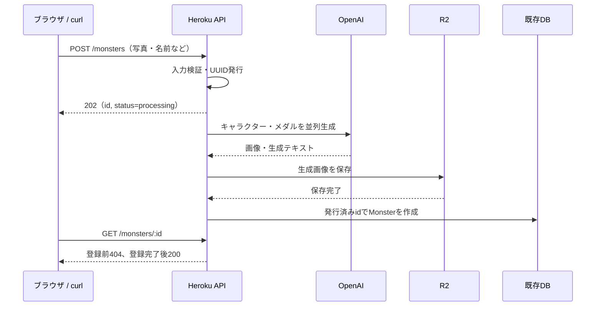

# Herokuでの画像生成・DB登録遅延の仕様

更新日: 2026-10-11（日本時間）。Vercelへの生成分離を取りやめ、既存APIの実行環境と設定を維持する方針へ変更した。

## 1. 目的と処理順

Herokuの30秒HTTPタイムアウトを回避するため、入力検証後に先に202を返し、同じNode.jsプロセスで画像生成・R2保存・DB登録を続ける。

処理順は必ず「画像生成 → R2保存完了 → DB登録」とする。受付時はUUIDを発行するだけで、DBレコードを作成しない。

Express・Prisma・既存DBスキーマ・CRUD構成、OpenAIとR2の認証情報の配置と読み込み方法を維持する。Vercel API、接続先URL、サーバー間認証トークン、Workflow、worker dyno、ジョブ用テーブルは使用しない。

Herokuの30秒制限はHTTP応答の待ち時間に適用される。先に応答を完了し、生成処理を応答待ちから切り離す。[Heroku Request Timeout](https://devcenter.heroku.com/articles/request-timeout)



## 2. API契約

### POST /monsters

既存URLと`multipart/form-data`を使う。

| フィールド | 必須 | 内容・制限 |
| --- | --- | --- |
| name | 必須 | trim後1〜100文字 |
| photo | 必須 | JPEG / PNGの写真1枚、最大4,000,000 bytes。シグネチャも確認 |
| skill | 任意 | とくぎの元になる文言、trim後0〜500文字。未指定は空文字 |
| personality | 任意 | DBへ保存する性格、trim後0〜500文字。未指定は空文字 |

入力と既存OpenAI・R2設定を確認してから202を返す。入力不備は400、サイズ超過は413、非対応形式は415、既存サービス設定の不備は503でJSONエラーを返す。

```json
{
  "id": "550e8400-e29b-41d4-a716-446655440000",
  "status": "processing"
}
```

`id`は後で作成する`Monster.id`。202を送信する時点ではDB未登録。`processing`は受付時の表現であり、保存・更新されるジョブ状態ではない。202は完了を保証しない。

応答後はOpenAIでキャラクター・メダルを生成する。キャラクターは必須、メダル生成だけの失敗は現行の任意扱いに合わせてnullで継続する。生成できた画像をすべてR2へ保存し、すべての保存が完了してから`prisma.monster.create`を実行する。生成できたメダルの保存失敗はDB登録を中止する。

画像キーは`<id>.png`と`<id>-medal.png`。DBには発行済みID、入力name・personality、保存先キー、生成されたskillを登録する。仮の画像キーや処理中レコードは登録しない。

後続処理の例外を捕捉してログに残す。202送信後は追加のHTTP応答を送らない。

### 結果確認とその他のCRUD

既存の`GET /monsters/:id`を使う。200はDB登録完了、404はレコード未登録を意味する。404だけでは処理中・失敗・未知のIDを区別しない。GETと202応答には`Cache-Control: no-store`を設定する。

一覧・名前更新・削除の契約は維持する。一覧には登録完了したMonsterだけが現れる。

## 3. フロント・モック

`postMonster`は202の受付IDを取得し、GETを3秒間隔で確認する。200のMonsterを現在の結果表示へ渡す。skill・personalityもFormDataに追加する。

404は期限内だけ確認を続け、404以外のHTTPエラー・通信失敗では確認を停止する。330秒までに登録を確認できない場合は「時間内に登録を確認できませんでした」と表示し、生成失敗が確定したとは表示しない。確認停止後に登録される場合もある。

同じIDの確認を重複実行しない。処理中の送信を防ぎ、画面終了時はGETの確認を中止する。クライアントの中断はHerokuの後続処理を停止しない。手動の再送は新しいIDで別の生成・登録を開始する。

開発用モックも202受付後にデータを作成し、GETで結果を取得する契約に合わせる。

## 4. 設定と時間制限

環境変数の読み込み方法は変更しない。Docker Composeは既存の`api/.env`、単体起動は`dotenv/config`を使用する。

| 設定場所 | 環境変数 |
| --- | --- |
| Heroku / api | 既存の`DATABASE_URL`、`CHATGPT_API_KEY`、`CLOUDFLARE_R2_API_ENDPOINT`、`CLOUDFLARE_R2_ACCESS_KEY_ID`、`CLOUDFLARE_R2_SECRET_ACCESS_KEY`、`CLOUDFLARE_R2_BUCKET_NAME` |
| フロント | 既存の`NEXT_PUBLIC_API_URL`、`NEXT_PUBLIC_R2_BASE_URL` |

新しいVercel接続設定や、Web側へのOpenAI・R2認証情報の移設は不要。`.env`は変更しない。

| 項目 | 初期値 |
| --- | --- |
| OpenAI生成期限 | 240秒、2枚並列 |
| 生成・R2保存の全体期限 | 270秒 |
| フロントの受付リクエスト期限 | 20秒 |
| 各GET確認リクエスト期限 | 10秒 |
| フロントの登録確認期限 | 202取得後330秒 |

モデルとプロンプトは従来の内容を使用する。OpenAI・R2の自動再試行は行わない。タイムアウトによって送信済みのOpenAI処理が停止することは保証しない。

## 5. 失敗時の扱い

| 失敗箇所 | DB | R2 | クライアントから見える状態 |
| --- | --- | --- | --- |
| 受付前の入力・設定確認 | 未登録 | 保存なし | 即時エラー |
| 必須画像の生成 | 未登録 | 保存なし | GETは404、確認期限で打ち切り |
| R2保存 | 未登録 | 部分的に残る可能性あり | GETは404、確認期限で打ち切り |
| DB登録 | 失敗または結果不明 | 保存済み画像が残る | GETの200で登録確認、404は期限で打ち切り |
| Herokuの再起動・デプロイ | 停止時点による | 停止時点による | 自動復旧しない |

途中失敗・プロセス再起動で処理が失われること、R2にDB未登録の画像が残ることを許容する。自動再試行・復旧・孤立画像の自動削除は実装しない。

ログにはID、段階、所要時間、エラー種別・コードを記録する。写真・Base64・認証情報・入力文全文は出力しない。

## 6. 実装と受け入れ条件

- `api/src/lib/image-generation.ts`: 既存OpenAI呼び出し・プロンプト・生成結果解析、R2保存の完了待ち。
- `api/src/lib/r2.ts`: 既存R2保存処理と設定、処理期限用AbortSignal。
- `api/src/routes/monsters.ts`: 202受付後に同じプロセスで生成・保存・DB登録。
- `api/openapi.json`: 202契約と既存サービスの設定エラー。
- `web/src/lib/api.ts`と開発用モック: 202受付とGETによる登録確認。

検証条件:

1. 新しいAPI接続URL・トークンなしで、既存のOpenAI・R2設定を使用できる。
2. 生成完了前に202を返し、その時点ではDB未登録である。
3. R2保存の一部が完了しても、すべて完了するまでDB登録しない。
4. 生成・保存失敗時はDB登録せず、応答後の例外を捕捉する。
5. 発行済みIDでDB登録し、既存GETから取得できる。
6. 一覧・詳細・更新・削除と、フロントのポーリングが動作する。

テストはOpenAI・R2をモックし、テストDBだけを使用する。API・Webの型チェックとテスト、lint、本番ビルド、品質ゲートを実行する。実API呼び出し・本番デプロイは検証に含めない。呼び出し例は`api/README.md`に記載する。
