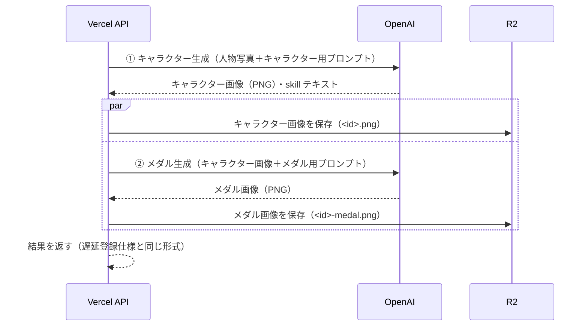

# メダル画像をキャラクター画像から生成する仕様

作成日: 2026-10-11（日本時間）。実装前の仕様。`docs/image-generation-deferred-registration.md`（以下「遅延登録仕様」）の生成処理部分を上書きする。

## 1. 目的

妖怪キャラクター画像と、メダル中央に描かれる妖怪を同じ見た目にする。

現行は同じ人物写真から、キャラクターとメダルを**別々に並列生成**している。2回の生成がそれぞれ写真を解釈するため、顔・髪型・配色・足の形などが一致しない。

変更後は**キャラクター画像を先に生成し、その画像を入力としてメダルを生成する**。メダル生成には人物写真を渡さない。

## 2. 変更範囲

| 項目 | 変更 |
| --- | --- |
| 生成順序 | 並列 → 直列（キャラクター → メダル） |
| メダル生成の入力画像 | 人物写真 → 生成済みキャラクター画像（PNG） |
| メダル生成のプロンプト | キャラクターのデザインを変えずにメダル化する指示へ変更 |
| 時間配分 | 呼び出しごとの固定240秒 → 全体期限内での配分（4章） |
| API契約（POST /monsters、POST /api/generations の入出力） | 変更なし |
| DBスキーマ・R2の保存先キー | 変更なし |
| フロント・モック | 変更なし |

実装場所は遅延登録仕様に従い、Vercel側の `web/src/lib/image-generation.ts`（現行の `api/src/routes/monsters.ts` にあった OpenAI 呼び出しの移設先）とする。本ブランチの `api/src/routes/monsters.ts` は生成処理を持たないため変更しない。

## 3. 処理の流れ



1. 人物写真とキャラクター用プロンプトでキャラクターを生成する。プロンプト・skill の抽出は現行どおり。
2. キャラクター画像が得られなければ、メダル生成を行わずに失敗を返す（422。現行と同じ）。
3. キャラクター画像のR2保存と、メダル生成を並行して開始する。待ち時間を短くするため。
4. メダル生成には、①で得たキャラクター画像のBase64を `input_image`（`data:image/png;base64,...`）として渡す。人物写真は渡さない。
5. 完了条件は遅延登録仕様と同じ。キャラクターと、生成できたメダルのR2保存がすべて成功してから応答する。

メダル生成の応答に含まれるテキストは使わない。`skill` は①のテキストのみから取る。

### 入力画像を受け渡す方式

生成済み画像を明示的に `input_image` として渡す。Responses API の `previous_response_id` による会話継続は使わない。理由は次のとおり。

- 1回目の応答の保存設定やサーバー側の状態に依存しない
- メダル生成に人物写真やキャラクター用プロンプトの文脈が混ざらず、再解釈による差異が出にくい
- テストで「2回目の入力画像＝1回目の出力画像」を直接検証できる

`image_generation` ツールで入力画像の再現度を上げるパラメーター（`input_fidelity: "high"` 等）が使用モデルで有効な場合は指定する。対応状況は実装時に確認し、未対応ならプロンプトのみで対応する。

## 4. 時間配分

直列化により所要時間が延びる。遅延登録仕様の「Vercel処理全体のアプリ側期限 270秒」は維持し、その中で配分する。

| 項目 | 値 |
| --- | --- |
| キャラクター生成のタイムアウト | 150秒 |
| メダル生成のタイムアウト | `min(150秒, 270秒 − 経過時間 − 20秒)` |
| メダル生成を開始する最低残り時間 | 30秒。下回る場合はメダル生成を行わない |
| R2保存の予備時間 | 20秒 |

- メダル生成のタイムアウト・スキップは、メダル生成失敗と同じ扱い（`medalFilename: null`）でDB登録まで進める。
- Vercel Function の maxDuration 300秒、Herokuの待機期限290秒、フロントの確認期限330秒は変更しない。
- 数値は初期案。実測の生成時間を見て調整する。

## 5. 失敗時の扱い

| 失敗箇所 | 結果 |
| --- | --- |
| キャラクター生成（拒否・画像なし・タイムアウト） | メダル生成を行わない。422 / 504。DB未登録 |
| メダル生成（拒否・画像なし・タイムアウト・期限不足でスキップ） | `medalFilename: null` で成功を返し、DB登録する。ログに段階 `medal_generation` と種別を残す |
| キャラクター画像のR2保存 | 502。メダルが保存済みでもDB未登録（R2に残ることは許容） |
| メダル画像のR2保存 | 502。DB未登録（遅延登録仕様と同じ） |

メダルが `null` の場合、メダル生成をやり直す手段は初期版では用意しない。

## 6. メダル用プロンプト（初期案）

```
入力画像のキャラクターを、妖怪ウォッチのメダル風の円形画像の中央に配置してください。
キャラクターの顔・髪型・体型・配色・服装・足の形などのデザインは変更せず、入力画像と同一のキャラクターとして描いてください。
キャラクターを別のデザインに描き直したり、新しい要素を加えたりしないでください。
キャラクター全体がメダルの内側に収まるように配置してください。
キャラクターの周囲に金色の装飾的なフレームを描いてください。
背景は必ず完全に透過（透明）にしてください。
```

出力サイズは現行どおり `1024x1024`。キャラクター用プロンプトは変更しない。

## 7. 検証

自動テスト（OpenAI・R2はモック）:

- キャラクター生成の完了後にメダル生成が呼ばれる（並列でない）
- メダル生成の `input_image` が、キャラクター生成の出力画像と一致し、人物写真を含まない
- キャラクター生成が失敗した場合、メダル生成が呼ばれない
- メダル生成の失敗・タイムアウト・期限不足では `medalFilename: null` で成功を返す
- 応答形式（`id`・`imageFilename`・`medalFilename`・`skill`）が変わらない

実APIでの確認（最小回数）:

- 数枚の写真で生成し、キャラクター画像とメダル中の妖怪が目視で一致すること
- 1回あたりの総所要時間を記録し、4章の配分が妥当か確認する

## 8. 受け入れ条件

- メダル中の妖怪が、同じIDのキャラクター画像と同一のデザインに見える
- 人物写真はキャラクター生成にのみ使われる
- キャラクター生成失敗時に無駄なメダル生成を行わない
- メダル生成の失敗・時間切れでも、キャラクターが生成できていればDB登録される
- POST /monsters・POST /api/generations・GET /monsters/:id の契約に変更がない
