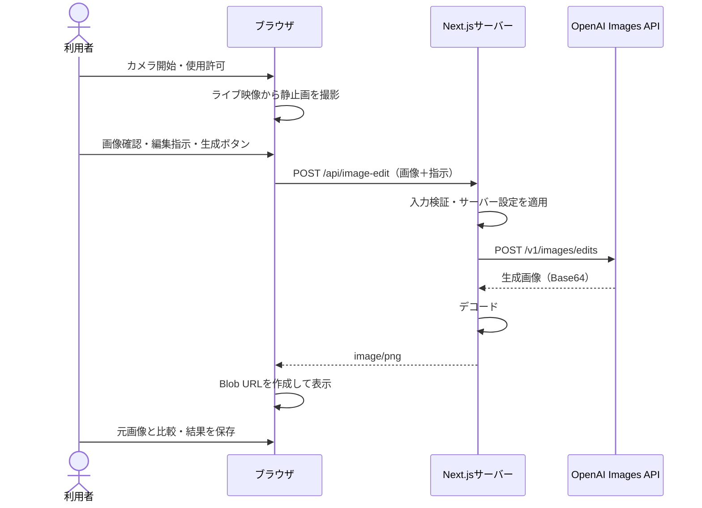

# Webカメラ → GPT Image プロトタイプ設計

設計日: 2026-10-10。対象: 現在のNext.js 16.4 / React 19.3プロジェクト。

## 1. 目的と範囲

Webカメラで撮影した静止画に編集指示を添え、OpenAIへ送信し、生成された画像を元画像と比較できるプロトタイプを作る。

初期版はlocalhostで使用する単一ユーザー向けとする。撮影と送信は別操作にし、送信前に画像を確認できるようにする。入力1枚、出力1枚、手動送信とし、データベース・画像履歴・自動連続送信は導入しない。

編集内容はテキストで指定する。例: 「写真の構図を保ちながら、水彩画風にしてください」。妖怪風などのプリセットは後から追加できる。

## 2. 構成と処理の流れ



OpenAIへは画像編集APIを使用する。画像入力と編集指示を一度に送れる。GPT Imageの出力はBase64画像として取得できる。[公式画像生成ガイド](https://developers.openai.com/api/docs/guides/image-generation)

ブラウザからOpenAIへ直接接続せず、APIキーはサーバーだけが保持する。

## 3. 既存実装との接続

`src/app/page.tsx`にはカメラ起動・停止、左右反転、Canvasによる撮影、PNG保存がある。この操作を維持し、撮影画像の下に編集フォームと結果表示を追加する。

現在は`canvas.toDataURL()`で写真を保持している。実装時には`canvas.toBlob()`でPNGのBlobを保持し、プレビュー用にObject URLを作る。撮影画像をFormDataへそのまま追加でき、Base64をリクエストに含める必要がなくなる。

現行の左右反転は撮影画像にも適用される。この仕様を維持し、画面に表示した撮影画像と送信画像を一致させる。

## 4. 画面と操作

PCでは撮影画像と生成画像を横に並べ、スマートフォンでは縦に並べる。

```text
カメラプレビュー
[左右反転] [カメラ開始 / 停止] [写真を撮る]

撮影画像                       生成結果
[元画像]                       [生成画像 / 待機表示]

編集指示 [複数行テキスト入力                      ]
「生成ボタンを押すと写真と指示をOpenAIへ送信します」
[画像を生成する]                [生成画像を保存]
```

- 写真がない、指示が空、処理中のいずれかなら生成ボタンを無効にする。
- 初期指示は編集可能なサンプルを入れる。アプリ側の指示上限は2,000文字。
- 処理中は「画像を生成しています」と経過秒数を表示する。進捗率や完了時刻を推測して表示しない。
- 初期版は処理中の再撮影・指示変更も無効にし、結果と入力の対応を明確にする。カメラ停止は可能とする。
- 成功した結果は元画像と比較して保存できる。再生成は明示操作とし、1回の操作で1枚生成する。
- 再撮影したら前の結果をクリアする。再生成失敗時は前の成功結果を保持し、「前回の結果」と明示する。
- エラーは日本語で表示し、撮影画像と編集指示は保持する。生成状態は`aria-live`で通知する。

## 5. アプリAPIの契約

### POST /api/image-edit

リクエストは`multipart/form-data`。ブラウザにboundary付きContent-Typeを設定させる。

| フィールド | 内容 | アプリ側制限 |
| --- | --- | --- |
| image | 撮影PNGファイル | 1枚、最大5 MiB |
| prompt | 編集指示 | trim後1〜2,000文字 |

サーバーは画像の必須チェック、個数、バイト数、MIMEとPNGシグネチャを検証する。プロキシでもリクエスト全体を制限し、FormData解析前の巨大な入力を防ぐ。最大辺1,280pxへの縮小はブラウザで実施し、縦横比を保つ。サーバーはクライアントの縮小をセキュリティ上の検証とは扱わない。

成功時はHTTP 200、`Content-Type: image/png`、`Cache-Control: no-store`で画像バイナリを返す。アプリのリクエストIDをレスポンスヘッダーに付ける。ブラウザはレスポンスをBlobとして受け取り、Object URLを表示・保存に使用する。

失敗時はJSONで`error.code`、安全な日本語の`error.message`、`requestId`を返す。OpenAIからのエラー本文や秘密情報をそのまま返さない。

| HTTP | アプリ内コード | 対処 |
| --- | --- | --- |
| 400 | INVALID_INPUT | 指示や画像を見直す |
| 413 | IMAGE_TOO_LARGE | 縮小して撮り直す |
| 415 | UNSUPPORTED_IMAGE | PNGとして撮り直す |
| 422 | GENERATION_REJECTED | 指示や画像を変更する |
| 429 | RATE_LIMITED | 時間を置いて手動で再試行 |
| 503 | SERVICE_UNAVAILABLE | APIキー・モデル権限・利用枠などを運用側で確認 |
| 502 | UPSTREAM_ERROR | 空の画像応答も含め、生成失敗を表示 |
| 504 | GENERATION_TIMEOUT | 完了状態が不明な旨を表示 |

APIキー未設定は送信前にサーバーで検出する。OpenAIの認証失敗をアプリ利用者のログイン失敗として表示しない。エラー判定は上流のHTTPステータスとエラーコードを組み合わせる。

## 6. OpenAIへのリクエスト

サーバーから公式Node SDKの`images.edit`を呼ぶ。モデル候補は`gpt-image-2.5-sunburst`とし、`OPENAI_IMAGE_MODEL`で変更可能にする。利用アカウントのモデルアクセスは実装時に確認する。[公式Image Edit API](https://developers.openai.com/api/reference/resources/images/methods/edit)

サーバー設定案: `image`に検証済みPNG、`prompt`に編集指示、`n=1`、`size=1024x1024`、`quality=low`、`output_format=png`。モデルと出力設定はブラウザから自由に指定させない。正方形出力のため構図が調整される可能性を説明し、元画像を無断で正方形に切り抜かない。

出力は`data[0].b64_json`を確認してPNGバイナリへ変換する。結果が空の場合は成功扱いにしない。SDK導入時に、そのバージョンの型と選択モデルの対応パラメーターを再確認する。

公式ガイドでは複雑な生成に最大2分かかる場合があるため、プロトタイプの上流タイムアウトは180秒、ブラウザは190秒を設計値にする。これはサービスの応答保証ではない。[公式ガイドの制約](https://developers.openai.com/api/docs/guides/image-generation#limitations)

## 7. 状態・二重送信・リソース

カメラ状態`idle / loading / live`と生成状態`idle / submitting / success / error`を分離する。既存のカメラ接続競合対策を維持する。

生成ボタンの無効化に加え、イベント開始時に同期的な送信ロックを取得する。クライアントのリクエスト番号で古い応答が新しい状態を上書きしないようにする。

SDKの自動リトライは初期版では無効にする。タイムアウトや切断後に上流が処理を続けている可能性があり、無条件の再送で重複生成を起こさないようにする。利用者の手動再試行は新しい生成であり、追加料金が発生し得る。

ページ終了時はMediaStreamの全trackを停止し、アプリへのfetchをAbortControllerで中断する。サーバーでも切断・タイムアウトをSDKへ伝える。ただし送信後の中断によってOpenAIの処理停止や課金停止を保証しない。

撮影画像・生成画像のObject URLは差し替え時とアンマウント時に解放する。アプリは画像をDBやディスクへ保存せず、入力・結果をブラウザとサーバーの一時メモリで扱う。OpenAI側の保持は別扱いとし、未確認の削除保証を表示しない。

## 8. 設定・実装ファイル案

| ファイル | 役割 |
| --- | --- |
| src/app/page.tsx | 既存カメラ、撮影Blob、編集フォーム、生成結果 |
| src/app/globals.css | 比較表示、処理状態、モバイルレイアウト |
| src/app/api/image-edit/route.ts | Node.jsで入力検証と画像レスポンス |
| src/lib/openai-image.ts | サーバー専用SDK呼び出し・タイムアウト・エラー整理 |
| .env.example | 値を含まない設定サンプル |
| README.md | 起動、APIキー設定、動作確認手順 |

環境変数は`OPENAI_API_KEY`、`OPENAI_IMAGE_MODEL`。ローカルは`.env.local`に設定する。APIキーに`NEXT_PUBLIC_`を付けない。Dockerではビルド引数やDockerfileに秘密情報を入れず、起動時にサーバーへ渡す。

現行画面の「映像・写真はこのブラウザ内で処理され、サーバーには送信されません」を、次の内容に変更する。

> カメラ映像はブラウザ内で表示します。「画像を生成する」を押すと、撮影した写真と編集指示をサーバー経由でOpenAIへ送信します。

ローカル検証は`http://localhost:3000`で行う。別端末のカメラ利用にはHTTPSを用意する。初期版はlocalhostに限定し、Dockerの公開ポートもホストの127.0.0.1へバインドする。公開運用へ進める場合は、生成エンドポイントに認証・Origin検証・ユーザー別レート制限・同時実行数制限を追加する。UIの二重送信防止だけでAPI利用を制限しない。

## 9. 実装順と受け入れ条件

1. Next.jsの同梱ガイドを読み、Route Handlerとサーバー専用コードの現行仕様を確認する。
2. Blob撮影・フォーム・結果表示をモック応答で接続する。
3. 入力検証とSDK呼び出しを実装し、エラーを整理する。
4. APIキーをサーバーへ設定して実カメラで1回生成し、結果を表示・保存する。

受け入れ条件:

- 撮影前・空の指示・処理中には送信できず、連打しても1回だけ送信される。
- 送信した静止画と画面の元画像が一致し、生成画像を表示・PNG保存できる。
- カメラ許可拒否、画像サイズ超過、APIキー不備、429、生成拒否、タイムアウト、空応答を扱える。
- 失敗しても元画像と指示が残る。APIキーがブラウザのリクエストやJSバンドルに含まれない。
- 停止・ページ終了でカメラが解放され、再撮影で古い結果が混ざらない。
- サーバーログにはリクエストID・時間・ステータスを記録し、写真・Base64・APIキー・編集指示本文は出力しない。

検証は入力検証と上流エラーのモックテスト、既存lint/build、実カメラでの手動確認を行う。実APIによる試験は料金が発生するため、必要な最小回数で実施する。

## 10. 現時点での確認事項

本書は設計のみ。アプリコードの変更や実APIへの送信は行っていない。既存作業中の画面・CSS・レイアウトも変更していない。

ホスト上の`node_modules/next/dist/docs/`は見つからなかった。コード実装へ進む際には、実際に依存関係がインストールされている環境（Dockerを含む）から同梱ガイドを確認する必要がある。

生成時間がホスティング環境のリクエスト上限を超える場合は、この同期方式をジョブキュー＋結果取得APIへ拡張する。初期版はローカルNodeサーバーで往復を検証する。
